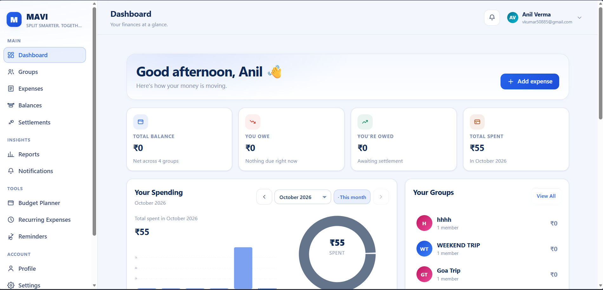
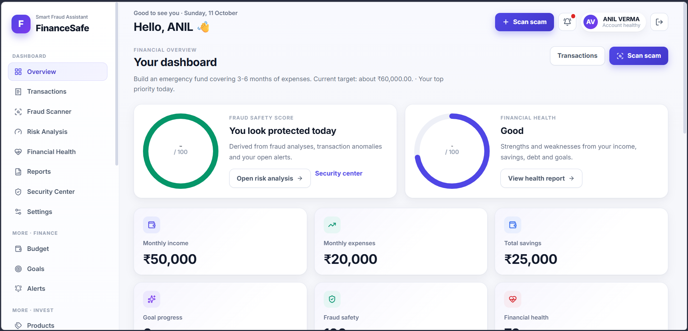
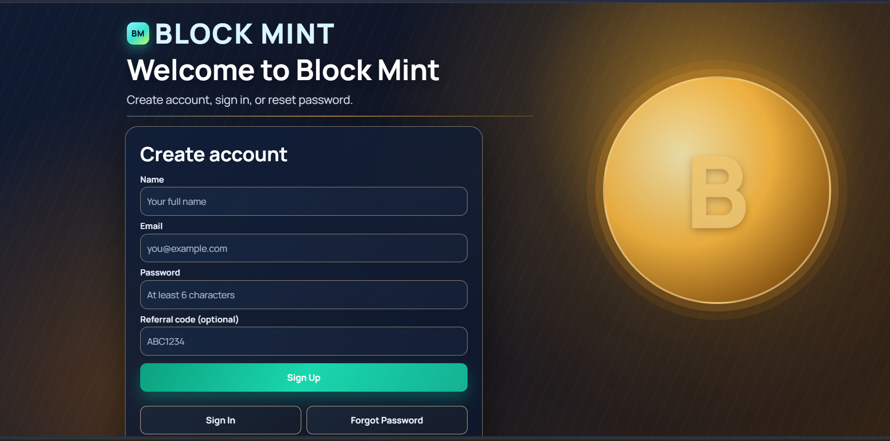

# Anil Verma — Personal Portfolio

**Turning ideas into digital experiences.**

A responsive, multi-page personal portfolio built entirely with HTML and CSS. It presents my software engineering background, selected projects, technical skills, certifications, and interests — with no JavaScript and no build step required.

**Live website:** [anil-4115.github.io/anil-verma-portfolio](https://anil-verma-portfolio.vercel.app/)

---

## About Me

I am a Computer Engineering student specializing in Software Engineering at MIT Academy of Engineering, Pune (B.Tech, 2024–2028). I enjoy exploring how interfaces, application logic, and databases come together to form useful software, and I learn by building practical projects.

This portfolio documents the projects, skills, and learning milestones I can currently verify with source material — nothing more, nothing less.

## Features

- Multi-page layout with dedicated pages for about, skills, projects, certificates, experience, hobbies, and contact.
- Responsive design for desktop, tablet, and mobile screens, including a mobile navigation menu.
- Light and dark theme toggle using pure CSS.
- Project case studies with genuine application screenshots.
- Certificate cards linked to the original certificate PDFs.
- Résumé download link.
- Custom `404.html` page.
- CSS-powered interactions and animations that respect `prefers-reduced-motion`.

## Built With

- **HTML5** — semantic, accessible page structure.
- **CSS3** — custom properties, grid and flexbox layouts, media queries, and CSS animations.
- No JavaScript frameworks, backend servers, or databases — this site is fully static.

## Projects

### 01 · MAVI — Shared Expenses

A shared-expense web application covering groups, expense splitting, balances, and settlements. This case study is limited to the confirmed scope: calculation logic and interfaces for all six expense-splitting methods, manual checks, automated calculation tests, and frontend/backend/database integration.



- **Technology stack:** MERN — React, TypeScript, Node.js, Express, MongoDB, Mongoose
- **Source code:** [github.com/anil-4115/MAVI](https://github.com/anil-4115/MAVI)
- **Live demo:** [mavi-pearl.vercel.app/dashboard](https://mavi-pearl.vercel.app/dashboard)

### 02 · FinanceSafe — Financial Safety

A financial safety application combining scam-related checks with personal finance features. Confirmed scope includes scam scanning and risk scoring, finance tracking, account security, and integrated frontend/backend/database workflows.



- **Source code:** [github.com/anil-4115/FinanceSafe](https://github.com/anil-4115/FinanceSafe)
- **Live demo:** [financesafe-1.onrender.com](https://financesafe-1.onrender.com/)

### 03 · Block Mint — Web Application

A simulation platform reviewed from the supplied source archive, with account, dashboard, product, transaction, and administrative workflows backed by a Node.js and Express server.



- **Live demo:** [block-mint-kkcv.onrender.com](https://block-mint-kkcv.onrender.com/)
- **Source:** [github.com/anil-4115](https://github.com/anil-4115/)

## Certificates

The certificates page documents **18 credentials**, including Anthropic Academy AI & Claude courses, programming and web development courses, Cisco Networking Academy virtual internship, and a cybersecurity course. Every card links to its original certificate PDF, and dates are shown only where verified from the supplied documents.

## Project Structure

```text
anil-verma-portfolio/
├── index.html              # Home
├── about.html              # About me
├── skills.html             # Skills and technologies
├── projects.html           # Project case studies
├── certificates.html       # Certificates and learning
├── experience.html         # Experience and internships
├── hobbies.html            # Interests outside development
├── contact.html            # Contact details
├── 404.html                # Custom not-found page
├── .gitignore
├── README.md
├── css/
│   ├── style.css           # Shared design system and components
│   ├── responsive.css      # Responsive layout rules
│   └── animations.css      # Decorative, reduced-motion aware animations
└── assets/
    ├── images/
    │   ├── profile/        # Profile photographs
    │   ├── projects/       # Project screenshots
    │   └── hobbies/        # Hobby visuals
    ├── certificates/
    │   ├── previews/       # Certificate image previews
    │   ├── verified/       # Verified certificate PDFs
    │   ├── source-anthropic/
    │   └── source-other/
    └── resume/             # Résumé PDF
```

## Run Locally

1. Download or clone this repository.
2. Open the project folder.
3. Double-click `index.html` — or serve it from any static file server.

No package installation, build step, or configuration is required.

## Publish to GitHub Pages

1. Push these files to the `main` branch of your GitHub repository.
2. Open the repository on GitHub and go to **Settings → Pages**.
3. Under **Build and deployment**, choose **Deploy from a branch**.
4. Select the `main` branch and the `/ (root)` folder, then click **Save**.
5. Your site will be published at `https://<username>.github.io/<repository>/`.

Example: `https://anil-4115.github.io/anil-verma-portfolio/`

## Contact

- **Email:** [202401100015@mitaoe.ac.in](mailto:202401100015@mitaoe.ac.in)
- **GitHub:** [github.com/anil-4115](https://github.com/anil-4115/)
- **LinkedIn:** [anil-verma-aa297a3b1](https://www.linkedin.com/in/anil-verma-aa297a3b1)

---

*Built with HTML and CSS, with a focus on clear presentation and continuous learning.*
